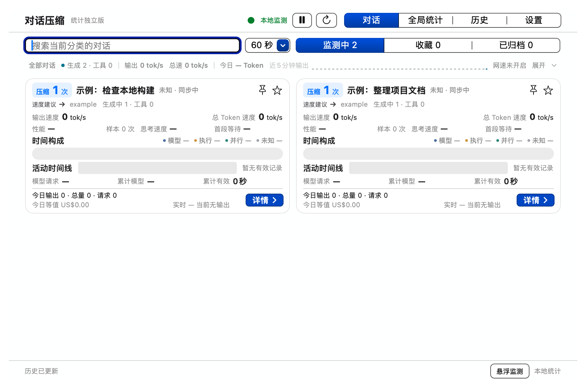

# ContextCruise

A macOS conversation monitor for Codex. The current statistics edition shows compaction counts, output speed, model and tool time, and token usage across conversations.

**[Download ContextCruise 11.21.45 for Apple Silicon](https://github.com/jack1231222/contextcruise/releases/download/v11.21.45-beta.1/ContextCruise-11.21.45-beta.1-macOS-arm64.dmg)** · [Release notes](https://github.com/jack1231222/contextcruise/releases/tag/v11.21.45-beta.1)

> **Upgrading from 1.0.0-beta.2?** In the ContextCruise app menu, turn on both **Receive Beta Updates（接收测试版更新）** and **Automatically Check for Updates（自动检查更新）**. When prompted, click **Install Update**. ContextCruise will install 11.21.45 and reopen automatically.

This public beta requires macOS 14 or later and has a Simplified Chinese interface. The [previous bilingual beta](https://github.com/jack1231222/contextcruise/releases/tag/v1.0.0-beta.2) remains available for macOS 13 and for users who prefer English.

Click the menu bar icon for the compact two-column conversation view. The single-line summary shows active generation and tools, output and total token rates, today's token count, a five-minute output trend, and machine download/upload rates when traffic monitoring is enabled. Expand the summary for full charts or open a card for performance, usage, compactions, and subagents.

Choose your local Codex data folder on first launch. Extra data sources and remote statistical reporting are optional. Cost figures are estimates, not bills.

[Installation](docs/INSTALL.md) · [Known limitations](docs/KNOWN_ISSUES.md) · [Privacy](PRIVACY.md) · [Changelog](CHANGELOG.md) · [Third-party notices](THIRD_PARTY_NOTICES.md)

Official releases are free to use under the [free-use license](FREE_USE_LICENSE.md). Proprietary source is maintained separately. This independent project is not affiliated with OpenAI.
