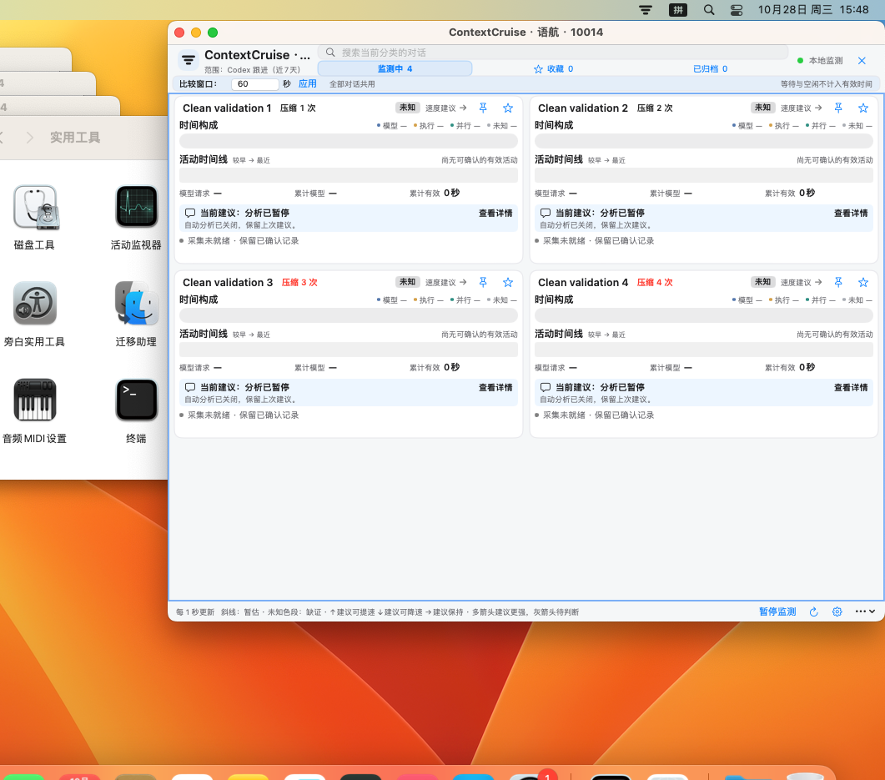

# ContextCruise · 语航

免费的 macOS Codex 对话监测工具。查看压缩次数、已确认的活动时间、对话状态与本地统计；支持搜索、收藏、归档视图及可选 AI 分析。

10014 基线在 macOS 13.4.1 干净虚拟机中的真实界面；使用四条合成测试记录，AI 分析关闭。

**当前公开测试版为 build 10015：App 与 DMG 已签名、公证，更新异常修复与隔离升级验证通过。最终包的 macOS 13.4.1 安装、真实脱敏记录读取、搜索与退出重开验证通过，已公开发布。** 公开 HTTPS 下载与 beta 更新源已通过公开访问核验，稳定渠道尚无正式版。

- Apple Silicon Mac；最低系统要求为 macOS 13。已在 macOS 13.4.1 干净虚拟机验证内置运行时、安装、合成记录读取和界面操作；10014 还读取了两份授权真实记录的脱敏快照；未在虚拟机运行实时 Codex。10015 也已通过该系统的最终包安装、真实脱敏快照读取与退出重开复核。其余系统与 Codex 版本组合未全部覆盖。
- 一个 App，自带 Python 运行时，无需自行安装 Python、Homebrew 或连接器。
- 软件免费，无 Pro、订阅、内购或两条对话数量限制。
- AI 默认关闭。只有配置并启用后才会向所选服务发送分析所需材料；API 费用由服务商收取。
- 本项目是独立工具，与 OpenAI 无隶属、赞助或官方认证关系。需要本机 Codex 记录，不能监测 ChatGPT 网页聊天。

## 使用与反馈

[中文安装说明](docs/安装与使用.md) · [English](README.en.md) · [隐私](PRIVACY.md) · [常见问题](docs/FAQ.md) · [已知限制](docs/KNOWN_ISSUES.md)

安装包只从本仓库 [Releases](https://github.com/jack1231222/contextcruise/releases) 提供。不会要求关闭 Gatekeeper 或删除隔离标记。

普通问题使用 [Issues](https://github.com/jack1231222/contextcruise/issues)。只提供版本、系统与脱敏后的步骤，不上传完整对话、auth.json、数据库、API Key 或个人路径。安全问题见 [SECURITY.md](SECURITY.md)。

自有源码暂不公开；允许个人与企业免费使用官方发行版，详见[免费使用许可](FREE_USE_LICENSE.md)。第三方组件沿用[各自许可](THIRD_PARTY_NOTICES.md)。
