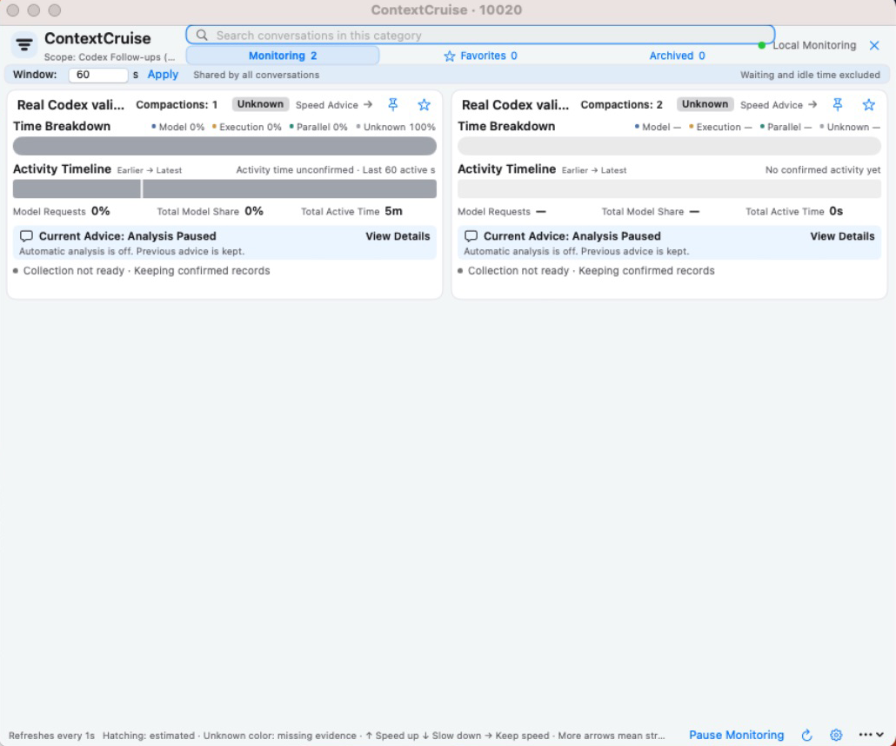

# ContextCruise

A free macOS companion for local Codex conversations. See compaction counts, observed active time, conversation state, search, favorites, and archived records. Optional AI provides conversation-handling advice.

Actual English interface in a clean macOS 13.4.1 virtual machine. Conversation content is test data; AI analysis is disabled.

**The current public beta is [v1.0.0-beta.2, build 10020](https://github.com/jack1231222/contextcruise/releases/tag/v1.0.0-beta.2).** The app supports English and Simplified Chinese. Choose a language in Settings and reopen the app to apply it. Repository pages, documentation, and issue forms use English. Your conversation titles and source excerpts stay in their original language.

- Apple Silicon Mac; macOS 13 or later. Build 10020 is tested on macOS 13.4.1. The full macOS/Codex compatibility matrix is not yet covered; see [tested scope and limitations](docs/KNOWN_ISSUES.md).
- One signed and notarized application with an embedded Python runtime. No separate Python, Homebrew, or connector installation is needed.
- Free for individuals and businesses. No Pro tier, subscription, in-app purchase, or two-conversation paywall.
- AI is off by default. If you configure and enable it, your selected provider may charge API fees. Local statistics do not make AI requests.
- An independent project, not affiliated with, sponsored by, or endorsed by OpenAI. Local Codex records are required; ChatGPT web conversations are not monitored.

Download the [Apple Silicon installer](https://github.com/jack1231222/contextcruise/releases/download/v1.0.0-beta.2/ContextCruise-1.0.0-beta.2-macOS-arm64.dmg). Read the [installation guide](docs/INSTALL.md), [FAQ](docs/FAQ.md), [privacy notice](PRIVACY.md), and [release notes](CHANGELOG.md).

Official installers are distributed only through this repository’s [Releases](https://github.com/jack1231222/contextcruise/releases). Keep Gatekeeper enabled and never remove security protections to install the app. Beta updates require explicit opt-in; no stable release is available yet.

Report ordinary bugs through [Issues](https://github.com/jack1231222/contextcruise/issues). Provide versions, redacted steps, and minimal screenshots. Do not upload full conversations, authentication files, databases, API keys, cookies, or personal paths. Report security issues through the [private reporting process](SECURITY.md).

Proprietary source code remains private. The [free-use license](FREE_USE_LICENSE.md) permits use of official releases; [third-party components](THIRD_PARTY_NOTICES.md) retain their own licenses.
